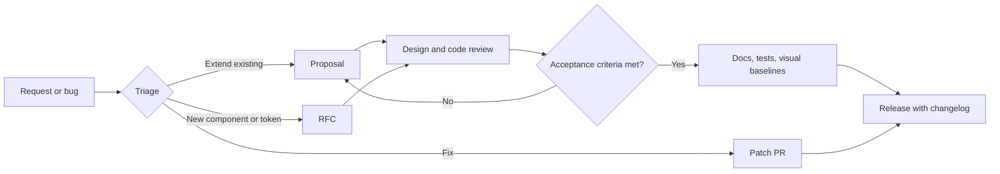

# Contribution workflow template



| Step | Owner | Service level | Exit criteria |
|---|---|---|---|
| Triage | DS maintainer on duty | 3 working days | Classified, linked to need |
| Proposal or RFC | Contributor | n/a | Problem, evidence of need in products, options, API sketch, states, a11y notes |
| Review | DS designer and engineer | 5 working days | Decision recorded with reasons |
| Build | Contributor with DS pairing | n/a | Tokens only, all states, tests, docs |
| Release | DS maintainer | Next release train | SemVer bump, changelog, Figma publish |

## Changelog entry format

```
## 3.4.0
### Added
- Chip: `size="sm"` (contributed by Payments squad). Docs: <link>.
### Deprecated
- `color.bg.light` replaced by `color.surface.subtle`. Removal planned in 4.0.0.
### Fixed
- Tooltip no longer traps focus (WCAG 2.1.2).
```
